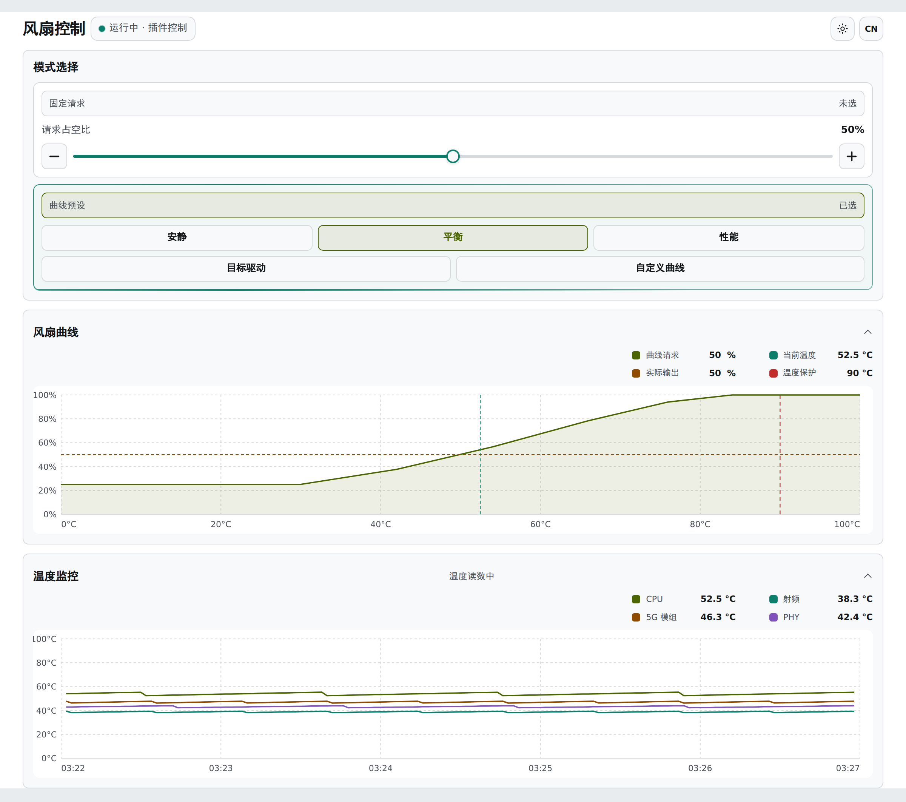
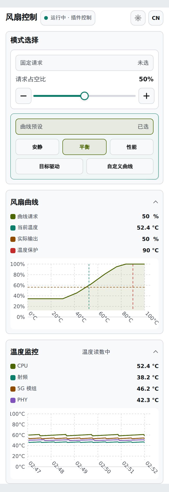
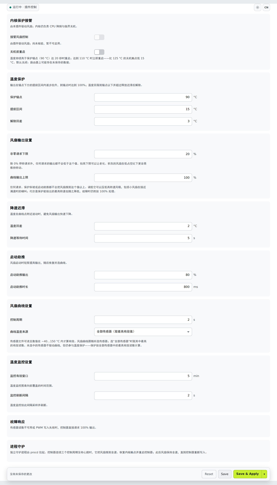

# ImmortalWrt 上的 H5000M 风扇控制

[](https://github.com/IRIS-Alpha/h5000m-pwmfan/actions/workflows/quality.yml)

**简体中文** · [English](README.en.md)

一个 LuCI 应用，在用户态驱动 Hiveton H5000M（OWT2510 板）的风扇，底层仍是内核的
`pwm-fan` 设备。它用闭环控制、风扇曲线编辑器和温度监控取代原厂风扇插件；内核热区
始终负责降频与临界关机。

| 仪表盘 — 1200 px | 仪表盘 — 360 px |
| --- | --- |
|  |  |

| 高级设置 — 1200 px | 高级设置 — 360 px |
| --- | --- |
|  |  |

截图来自本地预览桩（`tools/preview.py`），数据为演示值；布局、文案与图表几何与路由器上
Vantage 主题渲染的结果一致。

## 功能

- **模式**：固定占空比、三套曲线预设（静音 / 平衡 / 性能）、以目标温度为准的闭环，
  或自定义的六点曲线。
- **保护**：保护锚点、锚点下方的提前区间、解除回差；传感器读数或 PWM 写入失败时固定
  请求 100%。
- **接管**：一个开关把风扇从内核手里接过来；控制器会钉住两条最冷的 `pwm-fan` 触点，
  放手时再还原，CPU 降频与 125 °C 关机触点始终归内核。
- **进程守护**：一个独立看门狗进程监视控制器心跳，连续三个控制周期无心跳就把风扇推到
  全速、还原触点并重启控制器；控制器也反向监视看门狗。
- **可选的关机前重启**：默认关闭；开启后，温度停在保护锚点以上满 20 秒会重启，或者
  到达 100…120 °C 的设定值立即重启——该设定值应至少比 125 °C 关机触点低 15 °C。
- **监控**：四路温度来源的历史曲线，窗口与刷新间隔可调，图例每行在色块旁直接显示当前
  读数。
- 中英双语界面、明暗两套主题、图表可用键盘操作、尊重 `prefers-reduced-motion`。

行为保证（哪些事永远成立、一次“放手”到底意味着什么）见
[`docs/BEHAVIOUR_CONTRACT.md`](docs/BEHAVIOUR_CONTRACT.md)。

## 硬件与目标

| 项目 | 取值 |
| --- | --- |
| 设备 | Hiveton H5000M（OWT2510 板） |
| 固件 | ImmortalWrt SNAPSHOT，自定义 CI 构建 `r0-a4ba824`，LuCI master |
| 目标 | `mediatek/filogic`，`aarch64_cortex-a53` |
| 内核 | 6.18.60，`pwm_fan` 来自 `kmod-hwmon-pwmfan` |
| 包管理 | apk-tools 3.0.5（`packages.adb` 索引） |
| 主题 | Vantage（`luci-theme-vantage`） |

包本身与架构无关（`arch:noarch`）：里面只有 shell、Lua 目录和 JavaScript。固件侧如何
集成见 [`docs/FIRMWARE_INTEGRATION.md`](docs/FIRMWARE_INTEGRATION.md)。

## 安装

### 从签名 APK 仓库安装（运行中的系统）

```sh
wget -O /etc/apk/keys/h5000m-apk.pem \
  https://iris-alpha.github.io/h5000m-pwmfan/h5000m-apk.pem
echo "https://iris-alpha.github.io/h5000m-pwmfan/aarch64_cortex-a53/packages.adb" \
  >> /etc/apk/repositories.d/customfeeds.list
apk update
apk add luci-app-h5000m-pwmfan luci-i18n-h5000m-pwmfan-zh-cn
```

仓库用项目密钥签名（`packaging/h5000m-apk.pem`，
sha256 `d8827e250d7bbbb62acfc018e3e8fd5f29136dcd2b44c2ea569e44f2e1418aa0`），把公钥放进
`/etc/apk/keys/` 之后就不需要 `--allow-untrusted`。安装后控制器处于**关闭**状态：风扇
默认由插件接管（出厂 `enabled=1`）；在高级设置里关掉「接管风扇控制」才会把风扇交还内核，关掉后风扇按内核的 40 / 85 / 115 °C 触点运行。

### 编入固件

在固件源码树的 `feeds.conf.default` 里加一行，然后更新并选中包：

```sh
echo "src-git h5000m https://github.com/IRIS-Alpha/h5000m-pwmfan.git" >> feeds.conf.default
./scripts/feeds update h5000m
./scripts/feeds install -a -p h5000m
```

```
CONFIG_PACKAGE_luci-app-h5000m-pwmfan=y
CONFIG_PACKAGE_luci-i18n-h5000m-pwmfan-zh-cn=y
```

自定义固件已经通过 [`docs/patches/0001-fan-plugin-from-a-feed.patch`](docs/patches) 应用了
同样的配置，并带有 defconfig 断言与 manifest 检查：符号被静默丢弃时构建会失败，而不是
产出一个没有风扇插件的镜像。

### 手工复制

```sh
APK_SIGN_KEY=~/.h5000m-work/apk-keys/h5000m-private.pem sh tools/build-apk.sh
scp build/*.apk root@192.168.10.1:/tmp/
ssh root@192.168.10.1 'apk add --allow-untrusted --force-overwrite /tmp/*.apk'
```

## 仓库结构

```
luci-app-h5000m-pwmfan/      包本体（feed 布局：一个目录一个包）
├── Makefile                 LuCI 包定义（OpenWrt 与 apk 两种构建）
├── root/                    装到路由器上的文件
│   ├── etc/config/          uci 默认值与 init 脚本
│   ├── usr/sbin/            控制器、看门狗、状态与历史 helper
│   ├── usr/lib/             共享 shell 库（传感器、曲线、接管）
│   └── usr/share/           菜单、ACL、rpcd 权限
├── htdocs/                  LuCI 视图、样式与 Vantage 侧资源
└── po/zh_Hans/              翻译目录
docs/                        需求、证据、回滚、分发
tests/                       bats 套件与浏览器回归测试
tools/                       预览服务、检查、APK 构建/发布、设备探针
packaging/                   APK 信任锚（只放公钥）
```

## 运行方式

```
                 ┌──────────────────────────── LuCI views (browser) ───────────────────────────┐
                 │  dashboard: modes, fan curve, monitor     advanced: nine behaviour cards      │
                 └───────────────┬─────────────────────────────────────┬────────────────────────┘
                       ubus call │ uci                                 │ ubus file exec
                                 ▼                                     ▼
                    /usr/sbin/h5000m-pwmfan-status          /usr/sbin/h5000m-pwmfan-history
                                 │ reads                               │ reads
                                 ▼                                     ▼
                 /var/run/h5000m-pwmfan/status  ◄── writes ── /var/run/h5000m-pwmfan/temperature-history
                                 ▲
                                 │ heartbeat + snapshot each cycle
        procd ──► /usr/sbin/h5000m-pwmfan (daemon)
                     ├─ reads sensors: /sys/class/thermal, /sys/class/hwmon
                     ├─ computes duty: mode → floor → ceiling → protection ramp → kick
                     ├─ writes /sys/class/hwmon/…/pwm1
                     └─ pins the two coldest pwm-fan trip points while in control
                                 ▲ heartbeat
        procd ──► /usr/sbin/h5000m-pwmfan-watchdog
                     ├─ stale heartbeat ⇒ pwm 255, restore trips, restart the controller
                     └─ optional reboot before the shutdown trip
```

两个进程都是 procd 的独立实例、无限次重建；彼此不信对方的退出码，只认心跳文件。状态
文件是所有消费者的契约：`state`、`reason`、传感器行、`requested_pwm` / `effective_pwm`、
`protection_pwm`、`floor_pwm` / `floor_limited`、`stale_temperature`、`updated_at`。
（示意图沿用代码里的英文标识，便于与脚本对照。）

## 配置

所有键都在 `/etc/config/h5000m_pwmfan` 的 `main` 段。两个页面负责写入，表单在前后端都会
校验范围。

| 键 | 含义 | 默认值 |
| --- | --- | --- |
| `enabled`、`kernel_takeover` | 接管开关（一起写入） | `1` / `1` |
| `mode`、`curve_mode` | 当前模式与曲线预设 | `balanced` |
| `fixed_duty` | 固定请求，百分比 | `50` |
| `min_pwm`、`max_pwm` | 非零请求下限 / 曲线输出上限（0–255） | `51` / `255` |
| `protection_temp` | 保护锚点，°C | `90` |
| `protection_radius` | 提前区间，°C | `15` |
| `protection_release` | 解除回差，°C | `3` |
| `early_reboot`、`early_reboot_temp` | 关机前重启开关 / 重启温度 °C | `0` / `110` |
| `hysteresis`、`down_delay` | 降速迟滞 °C / 降速等待 s | `2` / `5` |
| `kick_pwm`、`kick_ms` | 启动助推输出 % / 时长 ms | `204` / `800` |
| `poll_interval` | 控制周期，秒 | `2` |
| `sensor_sources` | 曲线温度来源（`auto` 或 sysfs 标签） | `auto` |
| `history_range`、`history_interval` | 监控有效窗口（分钟）/ 监控刷新间隔（秒） | `5` / `2` |

## 开发

```sh
# 单元与集成检查（shellcheck、shfmt、bats、翻译、JS 语法）
STRICT=1 sh tools/check.sh

# 本地预览 http://127.0.0.1:8028（需要一份设备 rootfs 副本提供 LuCI 框架）
python3 tools/preview.py --port 8028 ~/Projects/.h5000m-work/rootfs

# 针对预览跑浏览器回归测试
PWMFAN_PREVIEW_URL=http://127.0.0.1:8028/cgi-bin/luci/admin/system/h5000m_pwmfan/dashboard \
  NODE_PATH=~/Projects/.h5000m-work/node_modules node tests/preview.mjs

# 构建并签名两个包
APK_SIGN_KEY=~/.h5000m-work/apk-keys/h5000m-private.pem sh tools/build-apk.sh

# 重新生成签名仓库并发布到 gh-pages 分支
sh tools/publish-apk-repo.sh --push
```

每个脚本与预览桩的限制分别写在 `tools/README.md` 和 `tests/README.md`。除非另有说明，
对设备的操作默认只读；`tools/device-snapshot.sh` 负责采集一份安全快照。

## 文档

从 [`docs/INDEX.md`](docs/INDEX.md) 开始。简表：

- [`docs/REQUIREMENTS_V5.md`](docs/REQUIREMENTS_V5.md) —— 唯一的需求基线。
- [`docs/TASKS.md`](docs/TASKS.md) —— 进度、验收块与决策记录。
- [`docs/RUNTIME_EVIDENCE.md`](docs/RUNTIME_EVIDENCE.md) —— 设备上的实际行为
  （[中文](docs/RUNTIME_EVIDENCE.zh-CN.md)）。
- [`docs/ROLLBACK.md`](docs/ROLLBACK.md) —— L1–L5 回滚手册
  （[中文](docs/ROLLBACK.zh-CN.md)）。
- [`docs/DISTRIBUTION.md`](docs/DISTRIBUTION.md) —— 仓库、签名与托管。
- [`docs/BUILD_AND_INSTALL.md`](docs/BUILD_AND_INSTALL.md) —— 不依赖 SDK 的打包。

## 安全提示

- 释放控制（`enabled=0`）后风扇会保持全速，直到有程序再次写入 `pwm1` 或路由器重启；
  它不会把占空比的控制权交还给内核。
- 本包从不禁用 CPU 降频或临界关机触点；拥有风扇期间，它只移动风扇自己的触点。
- 默认 20% 的下限来自新风扇的出厂启动点再加余量；老化或积灰的风扇可能在低于该值时
  停转，而插件仍以为它在转（风扇没有转速反馈）。

## 许可证

Apache-2.0，见 [`LICENSE`](LICENSE)。Vantage 主题与第三方组件各自保留原有许可。
