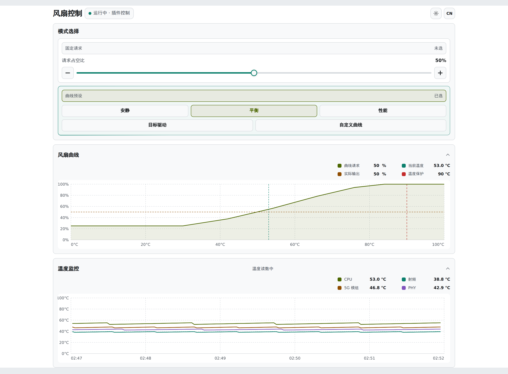
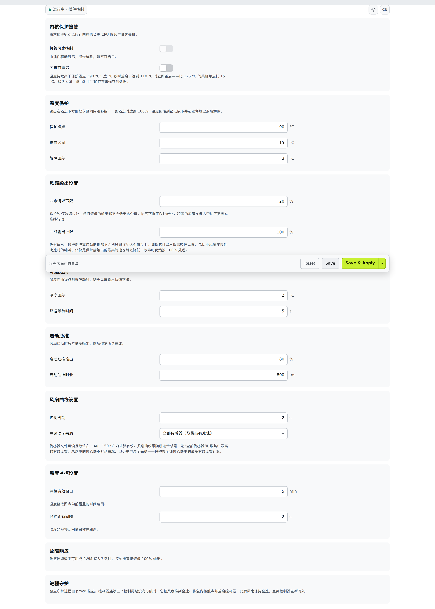
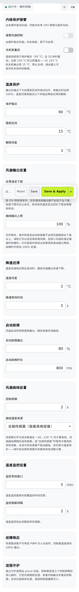

# H5000M PWM fan control for ImmortalWrt

[](https://github.com/IRIS-Alpha/h5000m-pwmfan/actions/workflows/quality.yml)

A LuCI application that drives the fan of the Hiveton H5000M (OWT2510 board) from userspace,
on top of the kernel's `pwm-fan` device. It replaces the stock fan plugin with a
closed-loop controller, a fan-curve editor and a monitor that keeps working while the
kernel thermal zones stay in charge of throttling and the critical shutdown.

| Dashboard — 1440 px | Dashboard — 360 px |
| --- | --- |
|  |  |

| Advanced settings — 1440 px | Advanced settings — 360 px |
| --- | --- |
|  |  |

Screenshots come from the local preview harness (`tools/preview.py`) with demo data; the
layout, labels and chart geometry are the ones the router renders in the Vantage theme.

## What it does

- **Modes**: fixed duty, three curve presets (quiet / balanced / performance), a closed loop
  on a target temperature, or a custom six-point curve.
- **Protection**: an anchor temperature, an early ramp window below it, a release hysteresis,
  and a fixed 100 % response when a sensor or a PWM write fails.
- **Handover**: one switch takes the fan from the kernel; the controller pins the two coldest
  `pwm-fan` trip points and restores them when it lets go, while CPU throttling and the 125 °C
  shutdown trip stay with the kernel.
- **Supervision**: an independent watchdog process watches the controller's heartbeat, pushes
  the fan to full duty, restores the trips and restarts it after three silent control cycles;
  the controller watches the watchdog back.
- **Optional reboot before shutdown**: off by default; when enabled it reboots after the
  temperature holds above the protection anchor for 20 seconds, or immediately at a set point
  100…120 °C that should stay at least 15 °C below the 125 °C shutdown trip.
- **Monitor**: a temperature history with four sources, configurable window and refresh
  interval, legend rows that show the live value next to each colour key.
- Chinese and English UI, light and dark theme, keyboard-reachable charts, `prefers-reduced-motion`
  respected.

The behaviour guarantees (what always happens, and what a release really means) are listed in
[`docs/BEHAVIOUR_CONTRACT.md`](docs/BEHAVIOUR_CONTRACT.md).

## Hardware and target

| Item | Value |
| --- | --- |
| Device | Hiveton H5000M (OWT2510 board) |
| Firmware | ImmortalWrt SNAPSHOT, custom CI build `r0-a4ba824`, LuCI master |
| Target | `mediatek/filogic`, `aarch64_cortex-a53` |
| Kernel | 6.18.60, `pwm_fan` via `kmod-hwmon-pwmfan` |
| Packages | apk-tools 3.0.5 (`packages.adb` indexes) |
| Theme | Vantage (`luci-theme-vantage`) |

The package itself is architecture-independent (`arch:noarch`): it ships shell, Lua catalogs
and JavaScript only. The firmware build is described in
[`docs/FIRMWARE_INTEGRATION.md`](docs/FIRMWARE_INTEGRATION.md).

## Install

### From the signed APK feed (running system)

```sh
wget -O /etc/apk/keys/h5000m-apk.pem \
  https://iris-alpha.github.io/h5000m-pwmfan/h5000m-apk.pem
echo "https://iris-alpha.github.io/h5000m-pwmfan/aarch64_cortex-a53/packages.adb" \
  >> /etc/apk/repositories.d/customfeeds.list
apk update
apk add luci-app-h5000m-pwmfan luci-i18n-h5000m-pwmfan-zh-cn
```

The feed is signed with the project key (`packaging/h5000m-apk.pem`,
sha256 `d8827e250d7bbbb62acfc018e3e8fd5f29136dcd2b44c2ea569e44f2e1418aa0`), so no
`--allow-untrusted` is needed once the key is in `/etc/apk/keys/`. Installation leaves the
controller **off**: the fan stays with the kernel until you turn on “Take over fan control”
in the advanced settings.

### Baked into the firmware

Add one line to `feeds.conf.default` of the firmware tree, then install and select the package:

```sh
echo "src-git h5000m https://github.com/IRIS-Alpha/h5000m-pwmfan.git" >> feeds.conf.default
./scripts/feeds update h5000m
./scripts/feeds install -a -p h5000m
```

```
CONFIG_PACKAGE_luci-app-h5000m-pwmfan=y
CONFIG_PACKAGE_luci-i18n-h5000m-pwmfan-zh-cn=y
```

The custom firmware already applies exactly this through
[`docs/patches/0001-fan-plugin-from-a-feed.patch`](docs/patches), with a defconfig assertion and
a manifest check so a silent drop fails the build instead of shipping a fan-less image.

### Manual copy

```sh
APK_SIGN_KEY=~/.h5000m-work/apk-keys/h5000m-private.pem sh tools/build-apk.sh
scp build/*.apk root@192.168.10.1:/tmp/
ssh root@192.168.10.1 'apk add --allow-untrusted --force-overwrite /tmp/*.apk'
```

## Repository layout

```
luci-app-h5000m-pwmfan/      the package (feed layout: one directory per package)
├── Makefile                 LuCI package definition (OpenWrt + apk builds)
├── root/                    files installed on the router
│   ├── etc/config/          uci defaults, init script
│   ├── usr/sbin/            controller, watchdog, status/history helpers
│   ├── usr/lib/             shared shell library (sensors, curves, takeover)
│   └── usr/share/           menu, ACL, rpcd permissions
├── htdocs/                  LuCI views, styles and the Vantage-side assets
└── po/zh_Hans/              translation catalog
docs/                        requirements, evidence, rollback, distribution
tests/                       bats suites and the browser regression test
tools/                       preview server, checks, APK build/publish, device probes
packaging/                   APK trust anchor (public key only)
```

## How it runs

```
                 ┌──────────────────────────── LuCI views (browser) ───────────────────────────┐
                 │  dashboard: modes, fan curve, monitor     advanced: nine behaviour cards      │
                 └───────────────┬─────────────────────────────────────┬────────────────────────┘
                       ubus call │ uci                                 │ ubus file exec
                                 ▼                                     ▼
                    /usr/sbin/h5000m-pwmfan-status          /usr/sbin/h5000m-pwmfan-history
                                 │ reads                               │ reads
                                 ▼                                     ▼
                 /var/run/h5000m-pwmfan/status  ◄── writes ── /var/run/h5000m-pwmfan/temperature-history
                                 ▲
                                 │ heartbeat + snapshot each cycle
        procd ──► /usr/sbin/h5000m-pwmfan (daemon)
                     ├─ reads sensors: /sys/class/thermal, /sys/class/hwmon
                     ├─ computes duty: mode → floor → ceiling → protection ramp → kick
                     ├─ writes /sys/class/hwmon/…/pwm1
                     └─ pins the two coldest pwm-fan trip points while in control
                                 ▲ heartbeat
        procd ──► /usr/sbin/h5000m-pwmfan-watchdog
                     ├─ stale heartbeat ⇒ pwm 255, restore trips, restart the controller
                     └─ optional reboot before the shutdown trip
```

Both processes are separate procd instances with unlimited respawn; neither trusts the other's
exit code, only its heartbeat file. The status file is the contract every consumer reads:
`state`, `reason`, sensor rows, `requested_pwm` / `effective_pwm`, `protection_pwm`,
`floor_pwm` / `floor_limited`, `stale_temperature`, `updated_at`.

## Configuration

All keys live in `/etc/config/h5000m_pwmfan`, section `main`. The two pages write them; the
form validates ranges on both sides.

| Key | Meaning | Default |
| --- | --- | --- |
| `enabled`, `kernel_takeover` | takeover switch (written together) | `0` / `0` |
| `mode`, `curve_mode` | active mode and curve preset | `balanced` |
| `fixed_duty` | fixed request, percent | `50` |
| `min_pwm`, `max_pwm` | non-zero request floor / curve output ceiling (0–255) | `51` / `255` |
| `protection_temp` | protection anchor, °C | `90` |
| `protection_radius` | early ramp window, °C | `15` |
| `protection_release` | release hysteresis, °C | `3` |
| `early_reboot`, `early_reboot_temp` | reboot before shutdown, set point °C | `0` / `110` |
| `hysteresis`, `down_delay` | downshift hysteresis °C / delay s | `2` / `5` |
| `kick_pwm`, `kick_ms` | startup boost output % / duration ms | `204` / `800` |
| `poll_interval` | control period, s | `2` |
| `sensor_sources` | curve sensor (`auto` or a sysfs label) | `auto` |
| `history_range`, `history_interval` | monitor window min / refresh s | `5` / `2` |

## Development

```sh
# unit and integration checks (shellcheck, shfmt, bats, translations, JS syntax)
STRICT=1 sh tools/check.sh

# local preview on http://127.0.0.1:8028 (needs a device rootfs copy for the LuCI framework)
python3 tools/preview.py --port 8028 ~/Projects/.h5000m-work/rootfs

# browser regression test against the preview
PWMFAN_PREVIEW_URL=http://127.0.0.1:8028/cgi-bin/luci/admin/system/h5000m_pwmfan/dashboard \
  NODE_PATH=~/Projects/.h5000m-work/node_modules node tests/preview.mjs

# build and sign both packages
APK_SIGN_KEY=~/.h5000m-work/apk-keys/h5000m-private.pem sh tools/build-apk.sh

# rebuild the signed feed and publish it to the gh-pages branch
sh tools/publish-apk-repo.sh --push
```

`tools/README.md` and `tests/README.md` document each script and the preview harness limits.
Device observations are read-only by default; `tools/device-snapshot.sh` collects a safe
snapshot.

## Documentation

Start at [`docs/INDEX.md`](docs/INDEX.md). The short version:

- [`docs/REQUIREMENTS_V5.md`](docs/REQUIREMENTS_V5.md) — the single requirements baseline.
- [`docs/TASKS.md`](docs/TASKS.md) — progress, acceptance blocks, decisions.
- [`docs/RUNTIME_EVIDENCE.md`](docs/RUNTIME_EVIDENCE.md) — what the device actually does
  ([中文](docs/RUNTIME_EVIDENCE.zh-CN.md)).
- [`docs/ROLLBACK.md`](docs/ROLLBACK.md) — L1–L5 rollback runbook
  ([中文](docs/ROLLBACK.zh-CN.md)).
- [`docs/DISTRIBUTION.md`](docs/DISTRIBUTION.md) — feed, signing, hosting.
- [`docs/BUILD_AND_INSTALL.md`](docs/BUILD_AND_INSTALL.md) — packaging without an SDK.

## Safety notes

- Releasing control (`enabled=0`) leaves the fan at full duty until something writes `pwm1`
  again or the router reboots; it does not hand duty control back to the kernel.
- This package never disables CPU throttling or the critical shutdown trip; it only shifts the
  fan's trip points while it owns the fan.
- The default 20 % floor is the new-fan factory ramp-up point plus margin; an aging or dusty
  fan may stop below it while the plugin still believes it is turning (there is no tachometer).

## License

Apache-2.0, see [`LICENSE`](LICENSE). The Vantage theme and third-party components keep their
own licenses.
